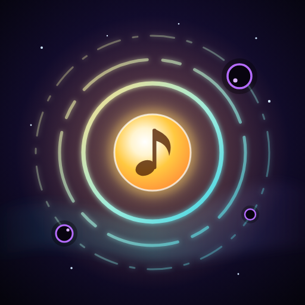

<p align="center"></p>

<h1 align="center">HUSH — Sing Back the Silence</h1>
<p align="center"><i>A rhythm survival game of light &amp; sound. The world forgot its song. Sing it back.</i></p>

<p align="center"><a href="https://dianteclark.github.io/HUSH---Sing-Back-the-Silence/"><b>▶&nbsp; Play HUSH now</b></a><br><sub>dianteclark.github.io/HUSH---Sing-Back-the-Silence — open on your phone and <i>Add to Home Screen</i></sub></p>

---

You are a small light in a world gone quiet. Dark **Hushlings** drift in to swallow every sound — and every weapon you wield is an *instrument*. Pulse fires on the beat, Thump is the kick drum, Snare Arc cracks on 2 &amp; 4, Glissando sweeps once a bar. **Your build is your band**: each voice you gain adds a layer to a soundtrack that is generated live from how you play. Every Hushling you silence plays a note; chain them into a harmony and the melody climbs.

## Play

- **Play online:** https://dianteclark.github.io/HUSH---Sing-Back-the-Silence/
- **Locally:** open `index.html` in any modern browser — no build step, no dependencies.
- **Install it:** host it (e.g. GitHub Pages), open it on your phone, and choose *Add to Home Screen*. It runs fullscreen with its own icon and works offline after the first load.

**Controls** — drag anywhere to move. Voices attack on their own, on the beat. Tap **DASH** (or tap with a second finger) — land it on the beat for a PERFECT. Tap ✺ for a Crescendo when the ring is full. Built for phones. `P`/`Esc` pauses, `1–4` pick harmonies, `R` rerolls.

## What's inside

- **The Score** — a 20-movement campaign in four acts, with 60 stars to earn
- **10 voices** (weapons that are also instruments), 5 levels each, up to 6 at once — your build *is* your band
- **6 Duets** — partner voices at their peak merge into something new
- **16 Motifs** and **8 Dissonances** — rule-bending gifts (and risky bargains) found in music boxes
- **7 Familiars** that follow you into every song
- **Perfect-beat dashing** with a visual metronome ring, and harmony tiers from *piano* to *tutti*
- **10 Singers**, each with their own voice, a signature Crescendo **Solo** and a 10-level Mastery
- **7 Songs** (+ seasonal **Hallow**) — Dawn, Dusk, Aurora, Abyss, Dream, and the living songs Tide and Ember — each its own musical mode, palette, difficulty and composed theme, and **9 Dynamics** per song from *p* to *∅ silenzio*
- Hushlings that move to the rhythm, four forms of the Hush, and a final boss — **The Great Silence** — that puts out the lights
- **Call & Response** rhythm events, Phantoms that only exist on the beat, Leeches, Resonant Crystals, Silence Zones, Silence Storms, Golden Notes, **Daily Hum** + **Daily Verses**, streaks, Resonance meta-progression, a **Songbook** collection, a **Wardrobe** of trails, 64 feats, seasonal events, **Modes** (Recital boss rush, Weekly Concert, Studio), the **Concert Hall** run history, shareable posters, twenty lore **Fragments**, Endless mode, and one-tap run sharing

All audio is synthesized in real time with the Web Audio API; all art is drawn procedurally on canvas. One HTML file.

## Project layout

```
index.html            the whole game
manifest.webmanifest  install metadata
sw.js                 offline cache (bump VERSION each release)
icons/                app icon (icon.svg is the source)
CHANGELOG.md
```

Made with every note.
